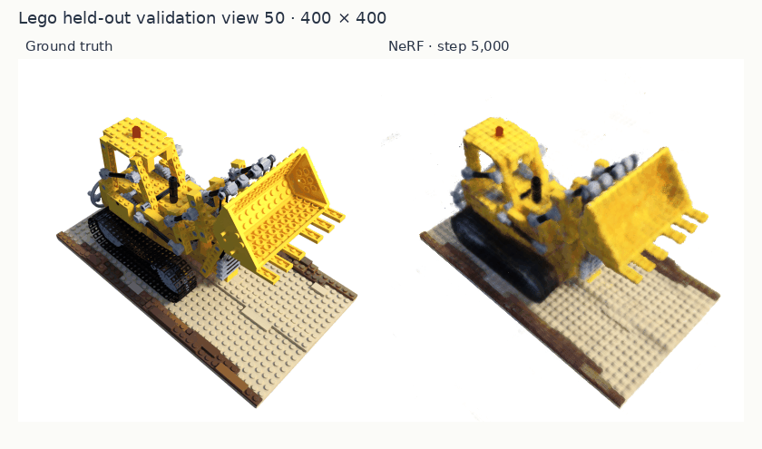
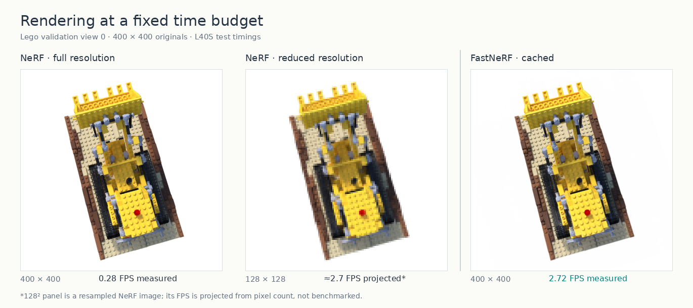
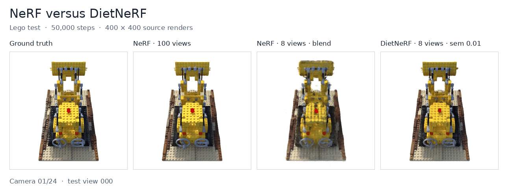
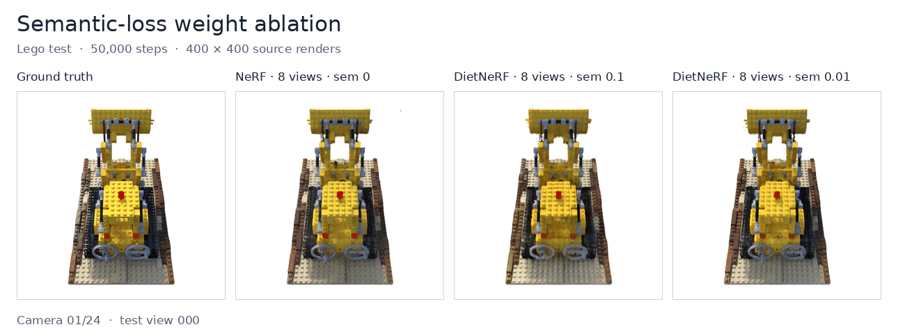

# 3D Reconstruction Lab

## Overview

An exploration of neural rendering and 3D reconstruction, focusing on **Neural Radiance Fields (NeRF)** and **3D Gaussian Splatting (3DGS)**. This project combines implementations from scratch, reproduction of existing methods, and experimental evaluation to understand different approaches to high-quality and efficient novel-view synthesis, as well as factors that influence performance.

### Neural Radiance Fields (NeRF)

- **NeRF from Scratch:** Implemented the original NeRF pipeline in PyTorch.
- **DietNeRF:** Reproduced a method for improving reconstruction quality under sparse-view settings.
- **FastNeRF:** Reproduced a method for accelerating neural rendering.

Experiments were conducted on the **NeRF-Synthetic Lego** dataset, with quantitative evaluations and visual comparisons.

### 3D Gaussian Splatting (3DGS)

*TBD*

## NeRF


**Scratch NeRF, from 5k to 200k steps.** 


**Same time budget.** At 400 × 400, NeRF rendered at 0.28 FPS and cached FastNeRF at 2.72 FPS on one L40S. The middle panel illustrates the roughly 128 × 128 resolution NeRF could afford at 2.72 FPS *if* runtime scaled with pixel count.


**50k-step renders.** Ground truth, 100-view NeRF, 8-view NeRF with a validation-selected coarse/fine blend, and 8-view DietNeRF (semantic weight 0.01).


**Eight-view semantic-weight comparison.** NeRF with weight 0 and DietNeRF with weights 0.1 and 0.01, rendered from matched test cameras.

### Methods

```text
3d-reconstruction-lab/
├── nerf/
│   ├── core/          # Shared NeRF model, encoding, rays, and volume rendering
│   ├── dietnerf/      # Sparse-view training with CLIP semantic consistency
│   ├── fastnerf/      # Factorized field, inference cache, training, and evaluation
│   ├── metrics/       # Blender data loading and PSNR, SSIM, LPIPS evaluation
│   ├── scripts/       # Lego download and validated cache evaluation
│   ├── assets/        # NeRF figures and GIFs used in this README
│   ├── run_nerf.py    # Scratch NeRF training entry point
│   ├── pyproject.toml # NeRF dependencies and environment settings
│   └── uv.lock        # Locked dependency versions
├── 3dgs/              # Reserved for 3D Gaussian Splatting
└── README.md
```

[DietNeRF](https://arxiv.org/abs/2104.00677) (Jain et al., ICCV 2021) introduces semantic consistency to regularize sparse-view reconstruction. Our implementation uses a frozen CLIP image encoder and reuses the shared NeRF field and renderer. 

[FastNeRF](https://arxiv.org/abs/2103.10380) (Garbin et al., ICCV 2021) factorizes the radiance field into position-dependent density and color bases and direction-dependent basis weights. Our PyTorch implementation caches these outputs in dense grids to reduce MLP evaluation during rendering. 

This project presents simplified reproductions of NeRF, DietNeRF, and FastNeRF, with comparative experiments exploring their rendering quality, computational efficiency, and performance under sparse-view settings.

### Experimental Results
#### Few-shot Reconstruction

The Lego runs below used 50,000 steps, seed 42, 400 × 400 test images, and all 200 held-out test views. Scores are means over images; higher PSNR/SSIM and lower LPIPS are better.

| Method and output | Views | PSNR ↑ | SSIM ↑ | LPIPS ↓ |
| --- | ---: | ---: | ---: | ---: |
| NeRF, full-view fine | 100 | 28.807 | 0.9359 | 0.03927 |
| NeRF, sparse-view fine | 8 | 9.506 | 0.6980 | 0.53941 |
| NeRF, sparse-view coarse | 8 | 21.284 | 0.8096 | 0.14495 |
| DietNeRF, semantic weight 0.01 | 8 | 25.068 | 0.8947 | 0.06059 |

Vanilla NeRF suffers significant quality degradation under sparse-view supervision, especially in fine rendering. DietNeRF substantially improves reconstruction quality with only 8 training views (PSNR: 9.51 → 25.07, LPIPS: 0.539 → 0.061), approaching full-view NeRF performance through semantic regularization.

| Eight-view method | Semantic weight | PSNR ↑ | SSIM ↑ | LPIPS ↓ |
| --- | ---: | ---: | ---: | ---: |
| DietNeRF, softplus | 0.1 | 23.860 | 0.8688 | 0.08496 |
| DietNeRF, softplus | 0.01 | 25.068 | 0.8947 | 0.06059 |

A smaller semantic loss weight (0.01) achieves better reconstruction quality across all three metrics than a larger weight (0.1). This suggests that excessive semantic regularization may interfere with pixel-level reconstruction, as high-level semantic similarity does not necessarily align with fine-grained visual fidelity. A moderate weight may provide a better balance between semantic consistency and photometric accuracy.

#### Sped-up Rendering
Both models used 100 Lego training views, seed 42, and 200,000 optimization steps. Results use the same 200 held-out test views at 400 × 400. Times are median full-image rendering times after warmup and CUDA synchronization on one NVIDIA L40S.  
Below are experimental results.

| Method | Test PSNR | Seconds / image | FPS | GPU cache |
| --- | ---: | ---: | ---: | ---: |
| NeRF | 31.827 dB | 3.601 | 0.278 | — |
| FastNeRF field | 31.115 dB | 5.413 | 0.185 | — |
| FastNeRF 64³ cache | 17.237 dB | 0.368 | 2.721 | 50 MiB |
| FastNeRF 128³ cache | 20.581 dB | 0.361 | 2.774 | 400 MiB |
| FastNeRF 768³ FP16 cache | 30.803 dB | 0.368 | 2.717 | 42.2 GiB |

The **768³ cache renders 9.78× faster than NeRF**, with a **1.024 dB PSNR gap**. 


### Reproduction

Run the following commands inside `nerf/`.

#### 1. Set up the environment

Use Python 3.11, uv, and a CUDA-capable system.  
The lock file installs PyTorch 2.7.1 with CUDA 12.8 wheels.

```bash
uv sync --locked
```

#### 2. Download the data

```bash
bash scripts/get_lego.sh
```

The script verifies the original NeRF example archive and extracts Lego into `data/lego`.

#### 3. Run Scratch NeRF

Train the 100-view, 200k-step baseline:

```bash
uv run python run_nerf.py train --data data/lego --output runs/nerf --device cuda
```

Evaluate all 200 test views. The shared evaluator accepts a NeRF checkpoint and writes mean PSNR, median rendering time, FPS, and per-image values:

```bash
uv run python fastnerf/run.py test --data data/lego --checkpoint runs/nerf/checkpoint_latest.pt --output runs/eval_nerf --device cuda
```


#### 4. Run DietNeRF

Install the DietNeRF dependencies:

```bash
uv sync --locked --group dietnerf
```

Train the eight-view Lego experiment with semantic loss weight 0.01 for 50,000 steps:

```bash
uv run --group dietnerf python dietnerf/train.py --data data/lego \
  --output runs/dietnerf_8view --semantic-weight 0.01
```

Evaluate the final checkpoint on all 200 test views (PSNR, SSIM, and LPIPS):

```bash
uv run --group dietnerf python metrics/evaluate.py --data data/lego \
  --checkpoint runs/dietnerf_8view/checkpoint_latest.pt \
  --output runs/dietnerf_8view/test_metrics --lpips
```

#### 5. Run FastNeRF

Train the field used for the reported comparison. 

```bash
uv run python fastnerf/run.py train --data data/lego --output runs/fastnerf --device cuda
```

Evaluate the uncached field on the full test split:

```bash
uv run python fastnerf/run.py test --data data/lego --checkpoint runs/fastnerf/checkpoint_latest.pt --output runs/eval_fastnerf --device cuda
```

For the accelerated path, run the following command. It checks the 768³ FP16 cache against validation views before measuring test PSNR and FPS. This needs a 48 GB GPU.

```bash
uv run python scripts/evaluate_fastnerf_cache.py --data data/lego --checkpoint runs/fastnerf/checkpoint_latest.pt --output runs/eval_cache768
```

### Limitations

The implementations in this codebase differ from original implementations on details. The results cover one scene and one seed. They do not demonstrate the exact results in the original papers.

### Technical Blogs

*TBD*

## 3D Gaussian Splatting

*TBD*

## Acknowledgements

We thank the authors and maintainers of the following works and projects:

- [NeRF](https://www.matthewtancik.com/nerf) (Mildenhall et al., ECCV 2020) for the radiance-field formulation, reference implementation, and NeRF-Synthetic dataset.
- [DietNeRF](https://ajayj.com/dietnerf/) (Jain et al., ICCV 2021) for the semantic consistency method and [reference implementation](https://github.com/ajayjain/DietNeRF).
- [FastNeRF](https://microsoft.github.io/FastNeRF/) (Garbin et al., ICCV 2021) for the factorized radiance-field and caching method.
- [CLIP](https://github.com/openai/CLIP) and [OpenCLIP](https://github.com/mlfoundations/open_clip) for the pretrained visual representations and image-encoder implementation used by DietNeRF.
- [LPIPS](https://github.com/richzhang/PerceptualSimilarity) and [scikit-image](https://scikit-image.org/) for the perceptual and structural image-quality metrics.
